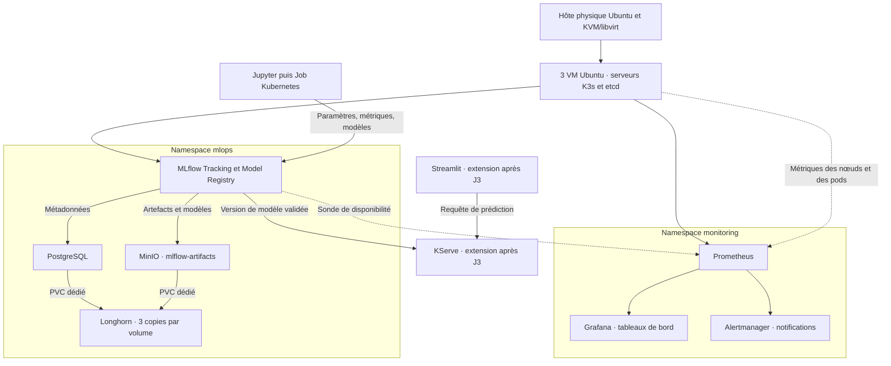

# Architecture générale — J1

**Sujet 4 · Plateforme MLOps avec MLflow sur Kubernetes**  
**Équipe · Oumayma Ennamous, Thanh Tu Vo et Marwa Boumour**

Ce document synthétise l’[architecture V3](proposition-oumayma-v3.md) pour le cadrage J1. Il décrit la cible commune, du suivi des entraînements à la supervision de la plateforme.

## 1. Infrastructure cible

La machine physique du laboratoire héberge trois VM Ubuntu Server via **QEMU/KVM et libvirt**. Les trois VM forment un seul cluster **K3s**. Chacune participe au plan de contrôle avec etcd embarqué et peut exécuter des pods. Ce choix permet de réserver les ressources de l’hôte aux VM et aux services du projet. Les décisions sont détaillées dans les [ADR-000](../adr/ADR-000-socle-kvm-libvirt.md) et [ADR-001](../adr/ADR-001-k3s-vs-kubeadm.md).

Avant le déploiement, vérifier la RAM, le disque, les interfaces réseau et la prise en charge de KVM. Fixer les adresses des VM et vérifier leur connectivité. Trois membres etcd permettent de conserver le quorum après la perte d’une VM. La disponibilité du cluster reste liée à celle de la machine physique.

## 2. Entraînement, suivi et stockage

- **California Housing** sert au POC de Thanh Tu pour valider le suivi d’un entraînement de régression. **Telco Customer Churn** est le cas principal de J3, avec comparaison d’une régression logistique et d’une forêt aléatoire pour prédire le départ d’un client.
- Le notebook, puis un Job Kubernetes, envoie les résultats à MLflow. MLflow Tracking conserve les paramètres et scores. Le Model Registry permet de versionner le modèle retenu et de documenter sa promotion.
- **PostgreSQL** conserve les métadonnées de MLflow. **MinIO** fournit le stockage compatible S3 pour les fichiers et modèles dans le bucket `mlflow-artifacts`. Chaque service possède son propre volume persistant. **Longhorn** réplique chaque volume sur trois nœuds distincts. `local-path` reste le plan B si les ressources sont insuffisantes, avec des volumes attachés à leur nœud. Voir l’[ADR-002](../adr/ADR-002-stockage-mlflow.md).
- **Après J3**, KServe expose une API de prédiction à partir d’une version validée du modèle. Streamlit collecte les informations du client, appelle cette API et affiche la prédiction.

## 3. Observabilité de la plateforme

**Prometheus** collecte les métriques du cluster et de ses charges. **Grafana** présente l’utilisation CPU/RAM/disque, l’état des pods et des Jobs, et la disponibilité de MLflow. **Alertmanager** transmet les alertes, par exemple lorsqu’un service devient indisponible ou qu’un Job échoue. Les scores des modèles et la comparaison des entraînements restent dans **MLflow**.

Au départ, les journaux sont consultés avec `kubectl logs`. **Loki et Alloy** restent optionnels et seront activés seulement si les mesures de RAM, de charge et de stockage laissent assez de marge. En cas de ressources limitées, réduire la collecte et la rétention de Prometheus. La démonstration doit montrer un tableau de bord, une alerte déclenchée et son retour à l’état normal. Voir l’[ADR-003](../adr/ADR-003-observabilite.md).

## 4. Validation et limites

Les tests sur VMware ont confirmé la persistance d’une donnée PostgreSQL et d’un objet MinIO après recréation des pods. Le déploiement sur KVM/libvirt et la supervision restent à valider sur la machine du laboratoire. PostgreSQL et MinIO démarrent chacun avec une seule instance. Leur reprise peut entraîner une interruption. Les copies Longhorn partagent l’hôte physique, donc les sauvegardes doivent être conservées hors de cet hôte et leur restauration testée.

Voir le [registre des risques](../risques.md), le [plan de travail](../plan-travail.md) et la [checklist J1](../jalons/J1-checklist.md).
