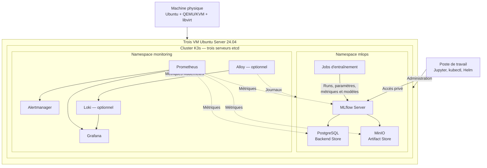

# Architecture v0 — Plateforme MLOps : MLflow sur Kubernetes

- **Date :** 6 novembre 2026
- **Équipe :** Oumayma Ennamous, Thanh Tu Vo et Marwa Boumour
- **Statut :** Proposition d'architecture à valider en groupe
- **Référence :** Sujet 4 — Plateforme MLOps : MLflow sur Kubernetes

## 1. Objectif et périmètre

L'objectif du projet est de mettre en place une plateforme MLOps basée sur Kubernetes permettant de suivre, comparer et gérer le cycle de vie des expériences et des modèles de Machine Learning avec MLflow.

La plateforme doit permettre de :
- Déployer un cluster Kubernetes avec K3s.
- Déployer PostgreSQL pour stocker les métadonnées MLflow.
- Déployer MinIO pour stocker les modèles et les artefacts.
- Installer MLflow pour suivre les expériences, comparer les entraînements et gérer le registre des modèles.
- Automatiser les entraînements et la recherche d'hyperparamètres au jalon J4.
- Mettre en place une observabilité permettant de surveiller les composants, consulter les journaux, visualiser les métriques et détecter les incidents.

L'interface de prédiction avec Streamlit et FastAPI constitue une extension optionnelle. Elle sera envisagée après la réalisation du cœur fonctionnel demandé.

## 2. Infrastructure et architecture technique

### 2.1. Infrastructure de virtualisation

Conformément à l'ADR-000, la solution proposée repose sur Ubuntu, QEMU/KVM et libvirt pour créer et gérer les machines virtuelles.

Cette solution évite d'ajouter la complexité d'une infrastructure OpenStack, qui n'est pas indispensable pour héberger le cluster Kubernetes du projet.

L'architecture cible prévoit trois VM sur la machine physique :
- Trois VM Ubuntu Server 24.04 LTS.
- Une installation K3s server sur chaque VM.
- Un datastore etcd embarqué pour assurer le quorum du cluster.
- Les nœuds pourront également héberger les applications et les jobs d'entraînement.

L'inventaire de la machine physique (CPU, RAM, disque et compatibilité KVM) reste à réaliser. Le dimensionnement définitif et la faisabilité des trois VM dépendront de cet inventaire.

**Limite :** les trois VM étant hébergées sur une même machine physique, cette architecture peut tolérer certaines pannes de VM ou de nœud, mais ne garantit pas la haute disponibilité en cas de panne de l'hôte physique.

### 2.2. Cluster Kubernetes et stockage

Le cluster K3s sera organisé en namespaces afin de séparer les applications MLOps de la supervision :

- `mlops` : MLflow, PostgreSQL, MinIO et jobs d'entraînement.
- `monitoring` : Prometheus, Grafana, Alertmanager et, sous condition de ressources, Loki et Alloy.

Conformément à l'ADR-002, PostgreSQL et MinIO seront déployés sous forme de StatefulSets avec des Services internes et des volumes persistants distincts.

Longhorn est retenu dans la proposition actuelle pour gérer les volumes persistants avec trois réplicas répartis sur les trois nœuds, sous réserve des ressources et de l'espace disque disponibles. Une politique d'anti-affinité stricte sera utilisée pour répartir les réplicas entre les nœuds.

Si Longhorn empêche le respect des contraintes du jalon, le plan B consiste à utiliser temporairement `local-path`, avec une perte de capacité de reprise sur un autre nœud clairement documentée.

## 3. Architecture générale

Le schéma suivant présente les principales couches de la plateforme et leurs interactions.

Les trois VM constituent un seul cluster K3s. Les composants applicatifs sont déployés dans les namespaces appropriés et peuvent être planifiés sur les nœuds selon les ressources disponibles.

Les communications entre les services de la plateforme se font principalement à l'intérieur du cluster. Les accès d'administration à Kubernetes, MLflow et Grafana sont limités au réseau privé ou à un accès contrôlé depuis le poste de travail.

## 4. Fonctionnement de la plateforme MLOps

### 4.1. Entraînement et suivi des expériences

Le développement et les premiers essais peuvent être réalisés depuis le poste de travail. Les entraînements destinés à la plateforme seront ensuite exécutés dans des Jobs Kubernetes.

Pour chaque entraînement :
1. Le script charge les données et applique le prétraitement prévu.
2. Le modèle est entraîné avec une configuration donnée.
3. Les paramètres et les métriques (accuracy, precision, recall, F1-score, etc.) sont enregistrés dans MLflow.
4. Le modèle entraîné et les fichiers associés sont envoyés dans le stockage des artefacts.
5. Les résultats des différents runs sont comparés dans l'interface MLflow.

### 4.2. Stockage et registre des modèles

MLflow utilise deux stockages complémentaires :

- **PostgreSQL :** backend store contenant les métadonnées des expériences, des runs, des paramètres, des métriques et du registre.
- **MinIO :** artifact store contenant les modèles entraînés, les fichiers et les autres artefacts.

Le serveur MLflow assure l'accès aux deux stockages. Les artefacts sont gérés en mode proxy afin d'éviter de distribuer directement les identifiants MinIO aux clients.

Après comparaison des expériences, un modèle pourra être enregistré dans le registre MLflow et une version retenue pourra être promue selon les critères définis par le groupe.

### 4.3. Automatisation — J4

Au jalon J4, les entraînements seront automatisés à l'aide de Jobs Kubernetes ou d'un mécanisme CI adapté.

La plateforme devra permettre de :
- Lancer plusieurs configurations d'entraînement.
- Réaliser une recherche d'hyperparamètres.
- Comparer les résultats obtenus.
- Suivre la durée et l'état des jobs.
- Enregistrer les résultats dans MLflow.

## 5. Observabilité de la plateforme 

L'observabilité fait partie intégrante de l'architecture dès le cadrage J1. Elle permet de surveiller le fonctionnement de la plateforme MLOps, de détecter les incidents et de mesurer ses performances.

Un namespace Kubernetes distinct nommé `monitoring` sera utilisé pour isoler les composants de supervision du namespace applicatif `mlops`.

### 5.1. Outils retenus

| Outil | Rôle |
|---|---|
| Prometheus | Collecter et conserver les métriques techniques de la plateforme. |
| Grafana | Visualiser les métriques et les journaux à travers des tableaux de bord. |
| Alertmanager | Recevoir et gérer les alertes déclenchées par Prometheus. |
| Loki — optionnel | Centraliser les journaux des applications et des composants Kubernetes. |
| Alloy — optionnel | Collecter les journaux et les transmettre à Loki. |

Prometheus, Grafana et Alertmanager constituent le socle principal de supervision. Loki et Alloy seront ajoutés uniquement si les ressources disponibles permettent leur fonctionnement sans dégrader les services MLOps.

### 5.2. Composants surveillés

La supervision portera sur les éléments suivants :

| Élément | Indicateurs suivis |
|---|---|
| Nœuds K3s | CPU, mémoire, disque et disponibilité. |
| Kubernetes | État des pods, redémarrages et état des volumes persistants. |
| MLflow | Disponibilité du serveur, erreurs et temps de réponse. |
| PostgreSQL | Disponibilité, connexions et activité de la base. |
| MinIO | Disponibilité, capacité de stockage et métriques exposées. |
| Jobs d'entraînement | État des jobs, succès, échecs et durée d'exécution. |

Les métriques techniques seront collectées par Prometheus à partir des endpoints disponibles, des exporters et des métriques Kubernetes. Les logs seront centralisés avec Alloy et Loki si cette extension est retenue.

Les métriques de qualité des modèles, telles que l'accuracy et le F1-score, resteront suivies dans MLflow. Elles ne doivent pas être confondues avec les métriques techniques de supervision.

### 5.3. Tableaux de bord et alertes

Grafana proposera trois vues principales :

- **Infrastructure :** utilisation CPU, mémoire, disque et état des nœuds.
- **Services MLOps :** disponibilité de MLflow, PostgreSQL et MinIO, état des pods.
- **Entraînements :** nombre de jobs, durée d'exécution, échecs et consommation des ressources.

Prometheus évaluera des règles d'alerte transmises à Alertmanager. Les premiers scénarios concerneront l'indisponibilité d'un nœud ou d'un service, les pods en échec, une consommation excessive de ressources et les jobs d'entraînement échoués.

Les seuils seront définis à partir des premières mesures du laboratoire. Les alertes seront vérifiées au moyen d'incidents contrôlés.

### 5.4. Mesures de performance — J4

L'observabilité permettra également de collecter les données nécessaires à l'évaluation des performances de la plateforme :

- Consommation CPU et RAM.
- Utilisation du stockage.
- Durée des entraînements.
- Disponibilité des services.
- Temps de détection des incidents.
- Surcoût en ressources lié à la supervision.

Une comparaison avec et sans collecte de métriques permettra d'évaluer le coût de l'observabilité sur les ressources disponibles.

## 6. Persistance, sécurité et sauvegardes

PostgreSQL et MinIO disposent de volumes persistants distincts gérés par Longhorn. La configuration des applications, des déploiements, des versions et des règles de supervision sera conservée dans le dépôt Git.

Les précautions suivantes seront appliquées :
- Les mots de passe et tokens seront conservés dans des Secrets Kubernetes et ne seront jamais déposés dans Git.
- Les services de stockage resteront accessibles uniquement depuis le réseau interne du cluster.
- Les accès d'administration seront limités aux utilisateurs autorisés.
- Les sauvegardes PostgreSQL et MinIO seront conservées sur une cible indépendante de la machine physique.
- Les procédures de restauration seront testées et documentées.
- Les données de supervision auront une durée de rétention adaptée aux capacités de stockage.

La réplication Longhorn ne remplace pas une sauvegarde : une panne de la machine physique peut affecter simultanément les trois réplicas.

## 7. Répartition des responsabilités

| Membre | Responsabilité principale | Contributions attendues |
|---|---|---|
| Oumayma Ennamous | Infrastructure et déploiement | KVM/libvirt, création des VM, automatisation de l'infrastructure et intégration de la plateforme. |
| Thanh Tu Vo | Kubernetes, stockage et chaîne ML | K3s, PostgreSQL, MinIO, MLflow, expériences et automatisation des entraînements. |
| Marwa Boumour | Observabilité | Prometheus, Grafana, Alertmanager, métriques, journaux, tableaux de bord, alertes et mesures de performance. |

Les responsabilités seront coordonnées et validées en groupe. Chaque membre documentera ses choix techniques et fournira les preuves correspondant à ses tâches.

## 8. Jalons et livrables

| Jalon | Date | Objectifs principaux |
|---|---|---|
| J1 | 06/11/2026 | Architecture, ADR, registre des risques, plan de travail et répartition des rôles. |
| J2 | 20/11/2026 | Infrastructure, cluster K3s, PostgreSQL et MinIO avec stockage persistant. |
| J3 | 15/12/2026 | MLflow opérationnel, expériences comparées et registre de modèles. |
| Rapport intermédiaire | 18/12/2026 | Documentation des travaux réalisés jusqu'à J3. |
| J4 | 22/01/2027 | Entraînements automatisés, recherche d'hyperparamètres, analyse et mesures de performance. |
| Gel | 29/01/2027 | Stabilisation et arrêt des nouvelles fonctionnalités. |
| J5 | 05/02/2027 | Reconstruction de la plateforme et démonstration de la reproductibilité. |
| Final | 12/02/2027 | Rapport final et démonstration du projet. |

## 9. Principales décisions et limites

Les décisions techniques sont détaillées dans les ADR associés :

- **ADR-000 :** KVM/libvirt plutôt qu'OpenStack all-in-one, sous réserve de validation des capacités de l'hôte.
- **ADR-001 :** K3s plutôt que kubeadm, avec trois serveurs et etcd embarqué.
- **ADR-002 :** PostgreSQL et MinIO pour les stockages MLflow, avec des volumes persistants Longhorn.
- **ADR-003 :** Prometheus, Grafana et Alertmanager pour l'observabilité ; Loki et Alloy sous condition de ressources.

Les principales limites identifiées concernent les ressources disponibles sur la machine physique, la capacité de stockage, la dépendance à un seul hôte et le coût supplémentaire des composants de supervision.

Des plans de repli sont définis dans les ADR et le registre des risques. Les choix proposés restent soumis à validation et les fonctionnalités ne seront considérées comme opérationnelles qu'après réalisation des tests et dépôt des preuves correspondantes.