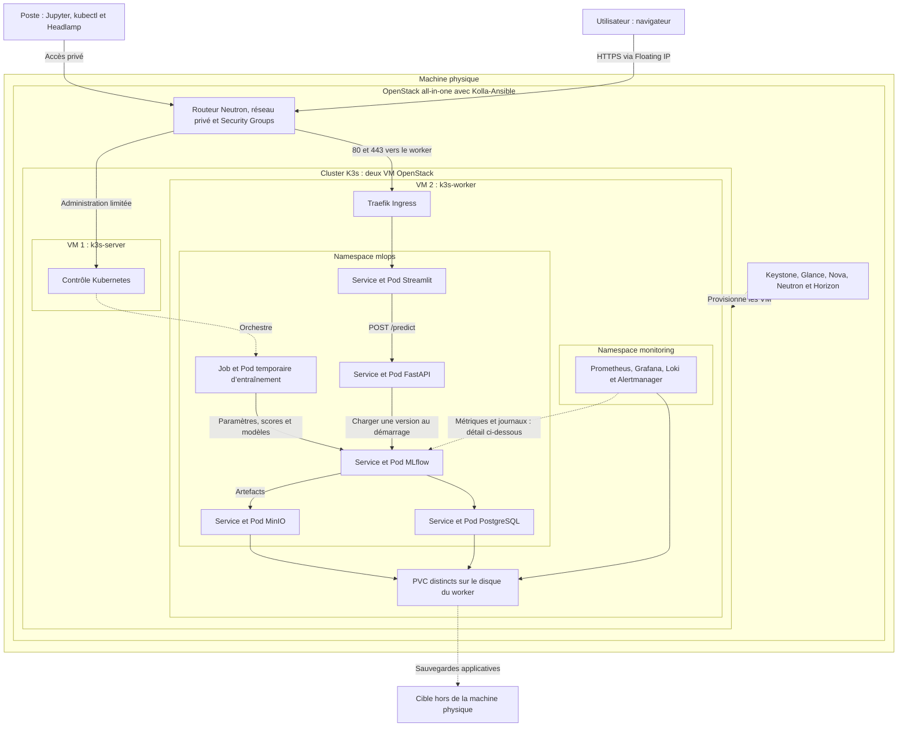
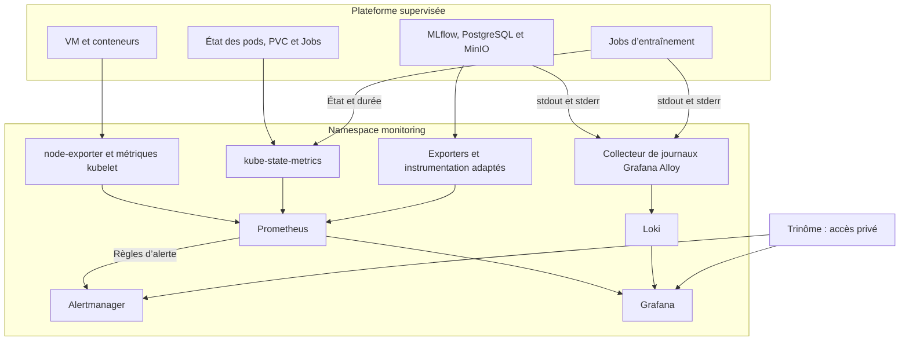

# Proposition d’architecture — Oumayma — V2

**Projet :** Sujet 4 — Plateforme MLOps : MLflow sur Kubernetes  
**Date :** 23 octobre 2026  
**Équipe :** Oumayma Ennamous, Thanh Tu Vo et Marwa  
**Statut :** proposition à valider en groupe.

Cette V2 complète la [version précédente](proposition-oumayma.md), conservée pour l’historique. Elle intègre l’observabilité confiée à Marwa par le professeur dès le cadrage J1.

## 1. Périmètre

- Socle choisi : OpenStack all-in-one déployé avec Kolla-Ansible. Les VM KVM/libvirt restent une alternative autorisée par les consignes communes.
- Cœur du sujet : K3s, PostgreSQL, MinIO, MLflow, comparaison d’expériences et registre de modèles.
- J4 : entraînement automatisé, recherche d’hyperparamètres et mesures.
- Observabilité demandée : métriques, journaux, tableaux de bord et alertes validées par des pannes provoquées.
- Extension optionnelle : Streamlit et FastAPI pour permettre à un utilisateur de demander une prédiction.

## 2. Infrastructure et placement

| Niveau | Composants | Rôle |
|---|---|---|
| Machine physique | Linux compatible avec la version de Kolla-Ansible retenue | Héberge le cloud ; compatibilité et ressources à vérifier avant installation |
| OpenStack all-in-one | Keystone, Glance, Nova, Neutron et Horizon | Identité, images, VM, réseau et administration |
| VM 1 : k3s-server | Ubuntu Server 24.04 LTS et K3s server | Contrôle du cluster et datastore K3s |
| VM 2 : k3s-worker | Ubuntu Server 24.04 LTS et K3s agent | Applications, entraînements et services centraux de supervision |
| Namespace mlops | MLflow, PostgreSQL, MinIO et Jobs ; Streamlit/FastAPI en extension | Plateforme ML |
| Namespace monitoring | Prometheus, Grafana, Loki, Alertmanager et collecteurs | Observabilité |
| Poste de travail | Jupyter, SSH, kubectl et Headlamp | Développement et administration |

La version exacte de K3s et toutes les dépendances seront figées dans les scripts. Le dimensionnement doit réserver les ressources d’OpenStack avant celles des VM.

Les applications sont placées explicitement sur le worker. Les collecteurs de nœuds peuvent fonctionner sur les deux VM ; les composants système K3s restent dans leurs namespaces système. Deux VM sur un hôte ne fournissent pas de haute disponibilité matérielle.

## 3. Architecture générale

Les liens vers les stockages représentent des dépendances ; ils ne sont pas tous sollicités lors d’une prédiction.

Neutron fournit la connectivité des VM. Une Floating IP du laboratoire permet l’accès au worker si le réseau externe le permet, sans supposer une exposition publique à Internet. Traefik doit être placé et configuré pour recevoir le trafic sur ce worker ; HTTPS nécessite un certificat adapté.

Les Services applicatifs sont de type ClusterIP. PostgreSQL, MinIO et l’API de prédiction restent internes. L’administration de MLflow, Grafana et Alertmanager passe par un accès privé, par exemple des port-forwards via un accès Kubernetes autorisé. Les Security Groups limitent SSH et l’API Kubernetes aux administrateurs et autorisent les communications inter-nœuds nécessaires au backend réseau choisi.

## 4. Parcours utilisateur, entraînement et modèle

### Prédiction — extension

1. Le navigateur rejoint l’interface Streamlit via le réseau OpenStack, Traefik et le Service web.
2. Streamlit transmet les données au Service FastAPI.
3. FastAPI valide les champs et utilise une pipeline scikit-learn comprenant prétraitement et modèle.
4. FastAPI renvoie la prédiction à Streamlit, qui l’affiche.

Le modèle est chargé depuis MLflow au démarrage de FastAPI, avec une version précise, puis reste en mémoire. Une prédiction ne relance pas d’entraînement. Une readiness probe empêche de servir le trafic tant que le modèle n’est pas chargé.

### Entraînement et promotion — cœur du sujet

1. Développer depuis Jupyter sur le poste de travail, puis exécuter le script dans un Job Kubernetes pour J4.
2. Identifier la version des données et du code ; utiliser les mêmes partitions et métriques pour comparer les modèles.
3. Enregistrer un run MLflow par configuration avec paramètres, scores et pipeline complète.
4. MLflow stocke les métadonnées dans PostgreSQL et les artefacts dans MinIO, en servant d’intermédiaire pour leur transfert.
5. Sélectionner sur la validation, évaluer le modèle retenu sur le test, l’enregistrer et le promouvoir dans le registre, par exemple via un alias champion.
6. Si l’extension prédictive existe, fixer la version servie et redéployer FastAPI.

La promotion dans le registre ne met pas automatiquement FastAPI à jour. Les données peuvent être stockées dans un bucket MinIO distinct avec accès limité au Job.

## 5. Observabilité — responsabilité de Marwa

Prometheus et Grafana sont demandés par le professeur. Loki et Grafana Alloy sont proposés pour la collecte des journaux et restent à valider.

| Composant | Fonction |
|---|---|
| Prometheus | Collecter et conserver les métriques opérationnelles |
| Grafana | Présenter métriques et journaux dans des dashboards |
| Loki et Alloy | Centraliser les journaux des services et des Jobs |
| Alertmanager | Regrouper et gérer les alertes évaluées par Prometheus |
| node-exporter et kubelet | Mesurer les ressources des nœuds et conteneurs |
| kube-state-metrics | Exposer l’état des ressources Kubernetes |
| Exporter PostgreSQL | Exposer les métriques de la base |
| Endpoint MinIO | Exposer les métriques disponibles dans la version retenue |
| Sondes ou instrumentation MLflow | Mesurer disponibilité et erreurs ; ne pas supposer un endpoint natif couvrant tous les besoins |

Les métriques ML comme F1 et accuracy restent dans MLflow ; Prometheus suit l’état et les performances de la plateforme. Les Jobs courts sont suivis par leur état Kubernetes et leurs journaux, sans supposer qu’un scrape capture toutes leurs métriques avant leur fin.

Les dashboards, configurations de collecte, règles d’alerte et rétentions sont versionnés. Aucune destination externe de notification n’est configurée avant son choix par le groupe.

## 6. Persistance et sécurité

| Données | Persistance initiale |
|---|---|
| PostgreSQL | PVC local dédié sur le worker |
| Modèles et artefacts MinIO | PVC local dédié sur le worker |
| Métriques Prometheus | PVC dédié avec rétention bornée |
| Journaux Loki | PVC local dédié avec rétention bornée, indépendant de MinIO au départ |
| Grafana et Alertmanager | Configuration provisionnée depuis Git ; PVC pour l’état à conserver selon la configuration |

Les volumes locaux survivent au remplacement des pods mais restent attachés au worker. Ils ne protègent pas contre la suppression du disque de la VM ou une panne physique. Prévoir des sauvegardes PostgreSQL et MinIO hors de l’hôte et tester leur restauration ; conserver aussi les preuves nécessaires aux mesures.

Cinder CSI et Octavia ne sont pas exigés pour le sujet 4. Un stockage indépendant du worker, éventuellement Cinder, est une évolution possible.

Les mots de passe et tokens restent hors de Git, dans des Secrets et un mécanisme de fourniture documenté. Éviter les données sensibles dans les journaux ; limiter la cardinalité des labels. Définir requests/limits, droits de collecte et règles réseau. Un Service ClusterIP ne remplace pas une NetworkPolicy.

## 7. Répartition proposée du trinôme

À valider ensemble et à rééquilibrer selon les temps passés et les blocages.

| Membre | Responsabilité principale | Livrables |
|---|---|---|
| Oumayma Ennamous | Infrastructure et déploiement MLflow | Kolla-Ansible, réseau, VM avec OpenTofu, automatisation, architecture, risques et intégration MLflow |
| Thanh Tu Vo | Kubernetes, stockage et chaîne ML | K3s, PostgreSQL/MinIO, expériences comparées, registre et automatisation des entraînements |
| Marwa | Observabilité | Prometheus/Grafana, métriques et journaux, dashboards, alertes, pannes contrôlées et mesures J4 |

Chaque membre documente sa partie et fait relire ses changements. Les interfaces entre MLflow, les stockages et la supervision sont testées ensemble. J5 est réalisé par un membre qui n’a jamais exécuté la reconstruction complète.

## 8. Jalons et preuves

| Jalon | Livrables |
|---|---|
| J1 — 6 novembre 2026, 18 h | Dépôt structuré, architecture courte de 2 à 3 pages incluant l’observabilité, ADR avec alternative et plan B, risques, plan et rôles du trinôme |
| J2 — 20 novembre 2026, 18 h | OpenStack, VM, K3s, PostgreSQL et MinIO persistants, reconstructibles par scripts ; objectif interne : premières métriques et journaux |
| J3 — 15 décembre 2026, 18 h | MLflow opérationnel, entraînements comparés, modèle enregistré et promu, preuves ; objectif interne : dashboards et premières alertes |
| Rédaction — 18 décembre 2026 | Sections J1–J3 et sauvegarde avant les vacances |
| J4 — 22 janvier 2027, 18 h | Jobs ou CI, hyperparamètres, analyse ; mesures de performance et alertes validées par pannes contrôlées |
| Gel — 29 janvier 2027 | Aucune nouvelle fonctionnalité |
| J5 — 5 février 2027, 18 h | Destruction et reconstruction chronométrées et filmées par un membre qui ne l’a jamais faite |
| Final — 12 février 2027, 18 h | Rapport, dépôt et démonstration scriptée avec make demo |

Les objectifs intermédiaires de supervision sont un planning proposé par le groupe ; le professeur demande son intégration dès J1 et des mesures pour J4.

### Protocole de mesures J4

- Fixer avant les essais : versions, données, partitions, ressources, scénario de charge, indicateurs et seuils d’alerte.
- Mesurer notamment durée des entraînements, transfert d’artefacts, CPU/RAM, stockage, disponibilité et délais de détection/rétablissement.
- Réaliser au moins trois répétitions par scénario ; conserver les valeurs brutes et présenter médiane et dispersion, par exemple min–max ou intervalle interquartile.
- Distinguer démarrage à froid et exécution à chaud.
- Pour le coût de l’observabilité, comparer un scénario avec et sans collecte dans les mêmes conditions et avec une mesure indépendante.
- Si l’API optionnelle est livrée, ajouter latence, débit et taux d’erreur.

### Alertes et pannes contrôlées

| Test | Résultat attendu | Preuve |
|---|---|---|
| Arrêt temporaire de MLflow | Indisponibilité détectée puis retour à la normale | Dashboard, alerte et horodatages |
| Interruption contrôlée de PostgreSQL ou MinIO | Dépendance indisponible et erreurs visibles | Alerte et journaux corrélés |
| Job volontairement invalide | Échec identifié | État Kubernetes, logs et alerte |
| Charge bornée sur un composant de test | Hausse de consommation visible | Courbes et comparaison des répétitions |

Effectuer ces tests uniquement dans le laboratoire, avec sauvegardes adaptées, procédure de retour à l’état initial et sans destruction non sauvegardée.

## 9. Reconstruction depuis le dépôt

| Couche | Automatisation proposée |
|---|---|
| Préparation hôte et OpenStack | Scripts et Kolla-Ansible |
| Réseaux et VM | OpenTofu et cloud-init |
| Configuration des VM et K3s | Ansible |
| Applications et stockage | Helm et manifests Kubernetes |
| Observabilité | Charts, exporters, dashboards, alertes et rétentions versionnés |
| Entraînements et démonstration | Scripts Python, images figées, Jobs et make demo |
| Sauvegarde et restauration | Scripts et procédure testée |

Le README décrit la procédure de A à Z, les prérequis réseau/disques, les versions, les secrets à fournir et les vérifications. Ce document est une proposition d’architecture, pas une preuve d’installation.

## 10. Décisions et risques à long terme

ADR à formaliser :
1. K3s comparé à kubeadm, avec plan B.
2. PostgreSQL et MinIO, stratégie de persistance et sauvegardes, comparés à une alternative.
3. OpenStack all-in-one comparé aux VM KVM/libvirt.
4. Si utile, choix de collecte et de rétention des métriques et journaux.

| Risque majeur | Réponse proposée |
|---|---|
| Complexité de maintenance de plusieurs couches | Versions documentées, automatisation et mises à jour testées |
| Capacité limitée à un hôte | Limiter les entraînements simultanés ; plan B : une VM K3s ; ajout de capacité à terme |
| Stockage attaché au worker | Sauvegardes testées et évolution vers un stockage indépendant du nœud |
| Croissance des métriques et journaux | Rétention bornée, labels contrôlés et suivi du stockage |
| Supervision et applications sur le même hôte | Une panne globale arrête les deux ; conserver les preuves hors hôte et envisager une sonde externe |
| Perte de connaissances après le départ du groupe | README complet, procédures et reconstruction croisée |

Si OpenStack bloque durablement les jalons, les VM KVM/libvirt constituent le plan B autorisé, à documenter dans l’ADR.

Cette proposition détaillée servira de base au document court de J1.
