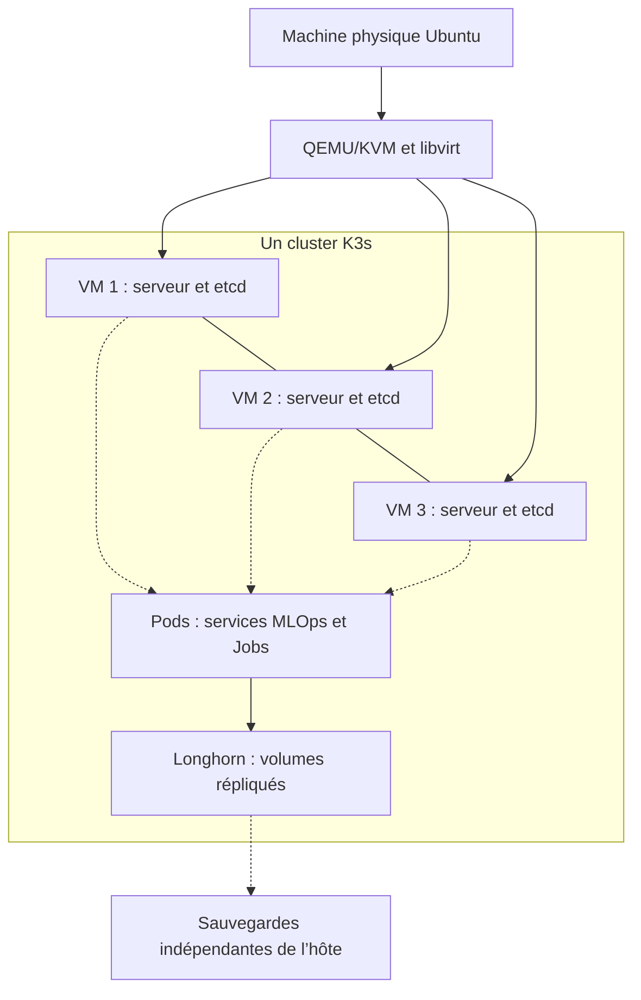
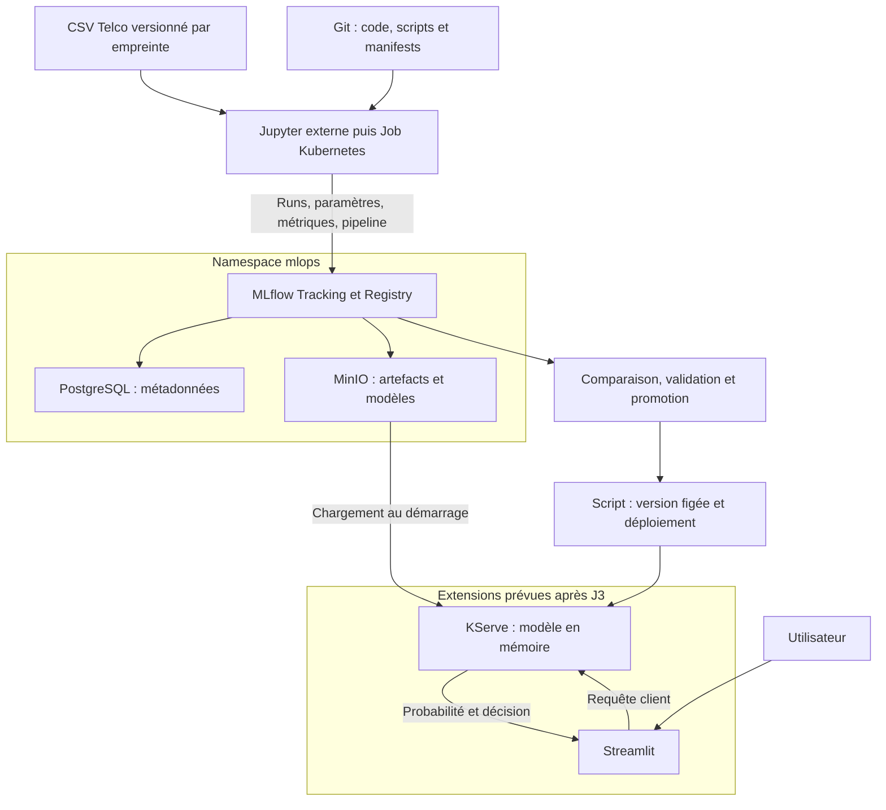

# Architecture J1 — Proposition Oumayma V3 : KVM/libvirt

**Sujet 4 — MLflow sur Kubernetes · 4 novembre 2026**
**Équipe :** Oumayma Ennamous, Thanh Tu Vo, Marwa Boumour.
**Statut :** référence proposée sur la branche `oumayma`, à relire en groupe. Succède à la [V2](proposition-oumayma-v2.md). Document court destiné au cadrage J1 ; compléments dans les ADR, risques et planning.

## 1. Objectif et périmètre

Construire une plateforme reconstructible qui trace les entraînements, compare les modèles et formalise leur cycle de vie. Le cas d’étude est le départ des clients télécoms : Telco Customer Churn, régression logistique et Random Forest. Le modèle inclut prétraitement et seuil de décision.

Le cœur obligatoire couvre K3s, PostgreSQL, MinIO, MLflow Tracking/Registry, comparaison et promotion d’une version. Les entraînements seront automatisés par Job Kubernetes ou CI pour J4. Prometheus/Grafana constituent le volet observabilité du groupe. KServe et Streamlit sont des extensions après J3 ; l’autoscaling à zéro n’est pas un objectif du sujet 4.

## 2. Infrastructure et choix structurants

Ubuntu Server sur la machine physique héberge QEMU/KVM et libvirt, qui exécutent trois VM Ubuntu. Un seul cluster K3s comporte trois serveurs avec etcd embarqué. Ces serveurs hébergent aussi les pods : aucun worker séparé n’est nécessaire au départ. Les applications sont placées par Kubernetes, sans fixer chaque service à une VM.

KVM/libvirt est autorisé par le brief et retenu pour limiter les couches et réserver les ressources au MLOps ; OpenStack reste une alternative documentée, pas une couche à installer en parallèle. Voir [ADR-000](../adr/ADR-000-socle-kvm-libvirt.md) et [ADR-001](../adr/ADR-001-k3s-vs-kubeadm.md).

**Dimensionnement à confirmer après inventaire.** Point de départ du laboratoire : 2 vCPU et 4 Gio de RAM par VM, 40 Gio système souhaités ; disque de données distinct pour Longhorn si possible. Ce n’est pas une garantie de capacité : réserver CPU/RAM pour l’hôte et mesurer la charge complète. Trois copies exigent environ trois fois l’espace des données, plus les surcoûts et snapshots. Lancer un entraînement à la fois au départ.

## 3. Architecture fonctionnelle et flux

1. Le CSV est identifié par SHA256 ; le code et les dépendances sont versionnés. Découpage stratifié entraînement/validation/test, sans réglage sur le test.
2. Jupyter puis un Job envoient un run par configuration à MLflow. Le serveur écrit paramètres, scores et registre dans PostgreSQL ; il transfère les fichiers vers le bucket `mlflow-artifacts` de MinIO. Les clients n’ont pas besoin des clés MinIO quand ce proxy est utilisé.
3. Le choix est fait sur la validation ; le test évalue le modèle retenu. Enregistrer une version, lui attribuer `candidate`, puis documenter la revue avant promotion, par exemple `champion`.
4. L’extension de déploiement résout l’alias en version immuable et déclenche une mise à jour KServe. Un changement d’alias seul ne recharge pas le serveur.
5. Streamlit appelle le Service KServe. Le modèle est chargé au démarrage et reste en mémoire ; chaque prédiction ne contacte pas PostgreSQL et ne relance pas l’entraînement. Une readiness probe conditionne l’ouverture au trafic.

Le runtime KServe doit être validé avec la pipeline, le seuil et les dépendances exactes ; un prédicteur personnalisé reste le plan B. Préférer le mode Standard, sans Knative, pour limiter les dépendances. Pas de FastAPI supplémentaire imposé entre Streamlit et KServe.

## 4. Stockage, réseau et exploitation

| Composant | Déploiement et état durable |
|---|---|
| PostgreSQL | StatefulSet, une instance initiale, PVC Longhorn dédié |
| MinIO | StatefulSet, une instance initiale, PVC Longhorn dédié |
| MLflow | Deployment et Service ; données durables externalisées |
| Longhorn | Trois copies visées par volume sur trois nœuds distincts ; contrôle de santé obligatoire |
| Supervision | Namespace `monitoring`, rétention et PVC bornés |
| Administration | Headlamp et kubectl depuis un poste autorisé |

IP fixes/réservations, MAC uniques, DNS et réseau inter-VM vérifiés avant K3s. Le plan IP VMware existant n’est pas copié aveuglément sur le réseau du laboratoire. Les Services internes utilisent le DNS Kubernetes. PostgreSQL et MinIO restent internes ; interfaces d’administration accessibles en privé. Prévoir une adresse stable d’API K3s avec bascule non dépendante d’une seule VM, et un point d’entrée Streamlit protégé. IP virtuelle, réseau et certificats restent à valider.

Secrets hors Git, RBAC au moindre privilège, NetworkPolicies, requests/limits et images figées. Le durcissement et HTTPS devront être vérifiés avant exposition hors laboratoire. La construction locale MinIO est à conserver dans un registre ou une archive durable accessible à tous les nœuds ; sa maintenance est un risque identifié.

Prometheus suit CPU/RAM, disques, pods/PVC/Jobs et disponibilité ; Grafana présente les tableaux de bord et Alertmanager les alertes. Les métriques ML restent dans MLflow. Journaux via kubectl au départ ; Loki/Alloy seulement après validation des ressources. Voir [ADR-003](../adr/ADR-003-observabilite.md).

## 5. Disponibilité, preuves et limites

Trois membres etcd tolèrent une perte de membre si le réseau reste fonctionnel. Une seule machine physique reste un point de panne global ; les réplicas Longhorn sur ses VM ne constituent pas une redondance matérielle. PostgreSQL et MinIO restent mono-instance : reprise possible avec interruption, pas de disponibilité continue garantie.

Sauvegardes indépendantes : snapshots etcd et jeton nécessaire à la restauration, sauvegardes PostgreSQL cohérentes, objets/configuration MinIO et manifests. Une cible hors hôte doit être identifiée et la restauration testée. Ne pas confondre snapshot, réplication et sauvegarde.

Le POC VMware est déclaré opérationnel dans les échanges (persistance SQL et S3 testée) ; le déploiement KVM, les scripts et les preuves dans Git restent à produire. Cette architecture est une cible, pas une attestation d’installation. Les [risques](../risques.md), [rôles/planning](../plan-travail.md) et [checklist J1](../jalons/J1-checklist.md) précisent responsabilités, preuves et critères de passage.
