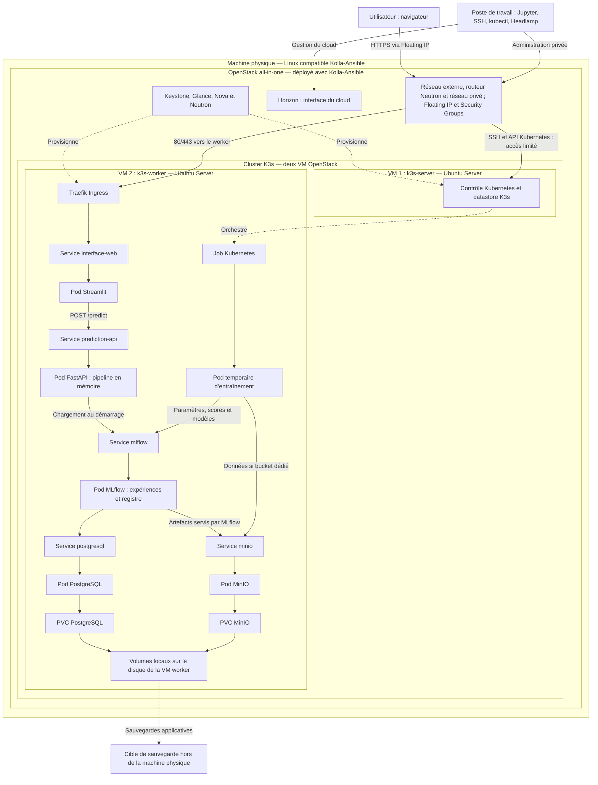

# Proposition d'architecture — Oumayma

**Projet :** Plateforme MLOps : MLflow sur Kubernetes  
**Date :** 23 octobre 2026  
**Statut :** proposition d’Oumayma avec OpenStack, à valider en groupe.

**Socle choisi :** OpenStack all-in-one avec Kolla-Ansible. Les consignes communes autorisent aussi les VM KVM/libvirt ; OpenStack est notre choix, pas une obligation propre au sujet 4.

## 1. Objectif et périmètre

Construire une plateforme permettant de suivre plusieurs entraînements scikit-learn, de comparer leurs résultats, de versionner le modèle retenu et d'automatiser l'entraînement sur Kubernetes.

Une extension propose une interface web permettant à un utilisateur de saisir des données et d'obtenir une prédiction. Cette interface et l'API de prédiction complètent le sujet ; elles ne remplacent pas les livrables MLOps demandés.

## 2. Infrastructure proposée

| Niveau | Choix proposé | Rôle |
|---|---|---|
| Machine physique | Linux compatible avec la version de Kolla-Ansible retenue | Héberge OpenStack ; OS et version à vérifier avant installation |
| Cloud | OpenStack all-in-one déployé par Kolla-Ansible | Fournit les VM et le réseau |
| Services du cloud | Keystone, Glance, Nova, Neutron et Horizon | Identité, images, calcul, réseau et administration |
| VM 1 | Ubuntu Server 24.04 LTS, K3s server | Contrôle du cluster |
| VM 2 | Ubuntu Server 24.04 LTS, K3s agent | Applications et Jobs d’entraînement |
| Kubernetes | K3s, version stable exacte à figer dans les scripts | Orchestration des pods |
| Namespace | `mlops` | Regroupe les applications |
| Stockage initial | PVC locaux sur le worker, avec sauvegardes externes | Persistance de PostgreSQL et MinIO |
| Administration | SSH, kubectl et Headlamp depuis le poste de travail | Gestion du cloud et du cluster |

La virtualisation matérielle doit être disponible sur l’hôte. Le dimensionnement et la faisabilité de deux VM restent à vérifier selon CPU, RAM et disques, en réservant aussi les ressources nécessaires à OpenStack.

**Cinder CSI et Octavia ne sont pas exigés pour le sujet 4.** Ils ne font pas partie du socle initial proposé. L’intégration PVC → Cinder peut être étudiée ultérieurement, mais ne doit pas bloquer J2.

## 3. Architecture générale

Le cluster K3s s’étend sur les deux VM. Dans cette proposition, les applications sont placées sur le worker à l’aide de règles de placement. Les flèches vers les services de données représentent des dépendances, pas l’ordre de chaque prédiction.

### Réseau et accès

- Neutron fournit un réseau privé pour les deux VM et un routeur vers le réseau externe du laboratoire.
- Une Floating IP du laboratoire permet de joindre le worker, si le réseau externe le permet ; cela ne suppose pas une exposition publique à Internet.
- Traefik est placé sur le worker et écoute sur les ports 80/443 via la configuration K3s retenue ; un certificat est à prévoir pour HTTPS.
- Les Security Groups autorisent le trafic nécessaire entre nœuds selon le backend réseau K3s ; SSH et l’API Kubernetes sont limités aux adresses d’administration.
- Les Services applicatifs sont de type ClusterIP ; l’API de prédiction et les stockages ne sont pas exposés directement à l’utilisateur.
- L’accès à MLflow se fait par un accès privé, par exemple un port-forward sur un chemin d’administration autorisé.
- L’accès Jupyter au serveur MLflow utilise cette adresse privée ; les noms DNS internes des Services ne sont pas directement résolus depuis le poste.
- Les pods applicatifs sont regroupés dans le namespace `mlops` ; les composants système restent dans leurs namespaces système.

## 4. Rôle des pods et des Services

| Composant | Rôle | Cycle de vie |
|---|---|---|
| Streamlit | Formulaire de saisie et affichage des prédictions | Permanent |
| FastAPI | Validation, prétraitement et inférence avec une version précise du modèle | Permanent |
| MLflow | Tracking des expériences, artefacts servis par proxy et registre des modèles | Permanent |
| PostgreSQL | Paramètres, métriques, informations des runs et du registre | Permanent, avec PVC |
| MinIO | Modèles sérialisés, graphiques et autres artefacts ; jeux de données dans un bucket distinct si nécessaire | Permanent, avec PVC |
| Entraînement scikit-learn | Entraîner les modèles et effectuer la recherche d'hyperparamètres | Temporaire, créé par un Job |
| Composants système K3s | DNS, Ingress, provisionnement du stockage et autres fonctions système | Gérés dans les namespaces système |

Chaque application est exposée en interne par un Service Kubernetes de type ClusterIP. Le Service fournit un nom stable même si le pod est remplacé. Les noms courts ci-dessous supposent un même namespace.

| Émetteur | Destination interne proposée | Usage |
|---|---|---|
| Streamlit | `http://prediction-api:8000/predict` | Requête de prédiction |
| FastAPI | `http://mlflow:5000` | Chargement de la version du modèle au démarrage |
| Jupyter ou entraînement | `http://mlflow:5000` depuis le cluster ; accès privé adapté depuis le poste | Tracking et transfert des artefacts via MLflow |
| MLflow | `postgresql:5432` | Base de données |
| MLflow | `http://minio:9000` | Stockage objet compatible S3 |

Jupyter peut rester sur le poste de travail. Headlamp sert à observer et administrer le cluster ; il ne traite aucune prédiction.

## 5. Parcours d'une demande utilisateur

1. L'utilisateur ouvre l'interface web et saisit les caractéristiques attendues.
2. Traefik route la connexion vers le Service Streamlit, puis vers son pod.
3. Streamlit envoie les données à l'API via le Service `prediction-api`.
4. FastAPI contrôle les types, les champs obligatoires et les valeurs.
5. La pipeline scikit-learn applique le prétraitement et calcule la prédiction.
6. FastAPI renvoie une réponse JSON ; Streamlit affiche le résultat.

Le modèle et son prétraitement sont chargés au démarrage du pod FastAPI et restent en mémoire. Une demande utilisateur ne déclenche ni entraînement ni téléchargement du modèle. PostgreSQL, MinIO et MLflow ne sont pas requis pour chaque inférence une fois le modèle chargé.

Si le modèle ne peut pas être chargé, l'API ne doit pas être déclarée prête à recevoir du trafic. Une readiness probe doit traduire cet état.

## 6. Parcours d'entraînement et de promotion

1. Charger un jeu de données versionné depuis une source identifiée.
2. Séparer les données en entraînement, validation et test.
3. Entraîner plusieurs modèles ou configurations sur les mêmes partitions et avec une métrique commune.
4. Créer un run MLflow pour chaque configuration ; enregistrer paramètres, scores, version des données et du code, ainsi que la pipeline complète.
5. MLflow écrit les métadonnées dans PostgreSQL et les artefacts dans MinIO.
6. Sélectionner le candidat sur la validation, puis l'évaluer sur le test.
7. Enregistrer une version dans le registre et lui attribuer un alias de promotion, par exemple `champion`.
8. Définir explicitement la version à utiliser par FastAPI et redéployer l'application.

La promotion dans le registre ne redéploie pas automatiquement l'API. Pour une première version, cette mise à jour est manuelle et documentée.

Pour J4, le code utile du notebook est extrait dans un script Python, emballé dans une image de conteneur et exécuté par un Job Kubernetes. Un Job peut entraîner plusieurs modèles successivement ; il n'est pas nécessaire de conserver un pod permanent par modèle.

## 7. Persistance, configuration et accès

- Un PVC dédié à PostgreSQL et un PVC dédié à MinIO.
- Une politique de conservation des volumes explicitée et des sauvegardes PostgreSQL et MinIO hors du disque de la machine.
- Des Secrets Kubernetes pour les mots de passe et clés d'accès ; aucune valeur sensible dans Git.
- Des ConfigMaps ou paramètres de déploiement pour les URL internes et la version du modèle.
- Seule l'interface utilisateur est exposée par l'Ingress ; l'API de prédiction, PostgreSQL et MinIO restent internes.
- MLflow est consulté via un accès privé, par exemple un port-forward dans une session d'administration adaptée.
- Les droits d'accès, le certificat HTTPS et les règles réseau sont à définir avant une exposition à Internet.
- Si les données d'entraînement sont dans MinIO, utiliser un bucket distinct et des identifiants limités aux besoins du Job.
- Une NetworkPolicy peut limiter les communications ; un Service ClusterIP ne constitue pas à lui seul une règle d'isolation entre pods.

## 8. Limites et plans B

- Une seule machine physique : aucune haute disponibilité, même avec deux VM.
- OpenStack ajoute une charge d’administration et de ressources ; réserver ces ressources avant de dimensionner les VM.
- Si les ressources sont insuffisantes pour deux VM, plan B : un cluster K3s à un seul nœud dans une VM OpenStack.
- Si OpenStack bloque durablement le projet, plan B de socle : VM KVM/libvirt, alternative autorisée par les consignes, avec décision documentée dans l’ADR.
- Les PVC locaux survivent au remplacement des pods, mais ne protègent pas d’une suppression du disque de la VM, d’une panne du disque physique ou de l’hôte. Ils restent attachés au worker ; leur disponibilité ne suit pas automatiquement un pod vers un autre nœud.
- Les entraînements et l'inférence partagent CPU et mémoire ; fixer les requests et limits et limiter les entraînements simultanés.
- Les ressources nécessaires dépendent des données et des modèles ; elles doivent être vérifiées avant le déploiement.
- Le cas d'usage, les variables du formulaire et la métrique de sélection restent à choisir.

## 9. Construction progressive et jalons

| Jalon | Livrables |
|---|---|
| J1 — 6 novembre 2026 à 18 h | Dépôt structuré, architecture courte de 2 à 3 pages avec schéma, au moins deux ADR avec alternative et plan B, registre des risques, plan de travail et répartition des rôles |
| J2 — 20 novembre 2026 à 18 h | OpenStack, VM, cluster K3s, PostgreSQL et MinIO avec stockage persistant ; reconstruction par scripts. Oral J1/J2 le matin |
| J3 — 15 décembre 2026 à 18 h | MLflow, plusieurs entraînements suivis et comparés, modèle enregistré et promu |
| J4 — 22 janvier 2027 à 18 h | Entraînement automatisé, recherche d’hyperparamètres et analyse des résultats ; protocole de mesure fixé à l’avance, au moins trois répétitions, médiane et dispersion |
| Rédaction — 18 décembre 2026 | Sections J1 à J3 et sauvegarde avant les vacances |
| Gel — 29 janvier 2027 | Arrêt des nouvelles fonctionnalités |
| J5 — 5 février 2027 à 18 h | Destruction et reconstruction par un membre qui ne l’a jamais faite, chronométrée et filmée |
| Rendu — 12 février 2027 à 18 h | Rapport, dépôt final et démonstration scriptée avec `make demo` |
| Extension | Streamlit et FastAPI pour la prédiction depuis une interface web |

## 10. Décisions à formaliser

- **ADR 001 :** choix de la distribution Kubernetes — proposition K3s.
- **ADR 002 :** stockage MLflow — proposition PostgreSQL et MinIO avec PVC.

- **ADR supplémentaire proposé :** choix du socle OpenStack all-in-one comparé aux VM KVM/libvirt, avec plan B explicite.

## 11. Reconstruction depuis le dépôt

| Étape | Automatisation proposée |
|---|---|
| Préparer l’hôte | Procédure de départ et scripts de préparation ; réseau et disques documentés |
| Déployer OpenStack | Inventaire et configuration Kolla-Ansible versionnés, sans secrets |
| Créer les VM et le réseau | OpenTofu : image, réseau, sous-réseau, routeur, Security Groups, VM et Floating IP |
| Préparer les VM et K3s | Ansible et configuration cloud-init |
| Déployer les applications | Helm et manifests Kubernetes versionnés |
| Entraîner et démontrer | Scripts Python, images versionnées, Job Kubernetes et `make demo` |
| Sauvegarder et reconstruire | Scripts de sauvegarde/restauration et procédure de destruction/reconstruction |

Le README doit expliquer la procédure de A à Z, depuis une machine de départ documentée. Figer les versions et dépendances, référencer le jeu de données et conserver les secrets hors du dépôt. Le stockage local doit avoir une politique de rétention explicitée ; les sauvegardes PostgreSQL et MinIO doivent être restaurables après destruction des VM.

Ce document décrit une cible ; il ne prétend pas que les composants sont déjà installés. Il sert de base au document court de J1, aux ADR et au plan de travail.

Voir le [journal de séance du 23 octobre 2026](../journal/2026-10-23.md).
