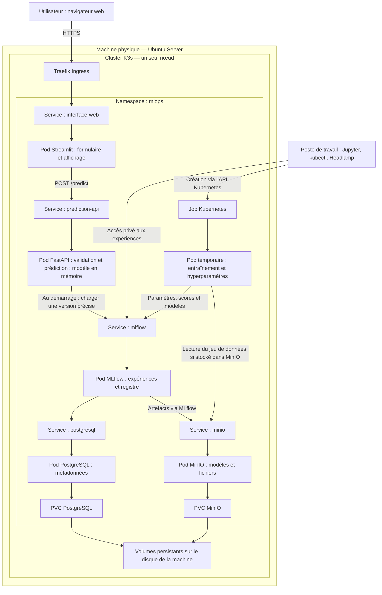

# Proposition d'architecture — Oumayma

**Projet :** Plateforme MLOps : MLflow sur Kubernetes  
**Date :** 23 octobre 2026  
**Statut :** proposition initiale à discuter et à valider en groupe.

## 1. Objectif et périmètre

Construire une plateforme permettant de suivre plusieurs entraînements scikit-learn, de comparer leurs résultats, de versionner le modèle retenu et d'automatiser l'entraînement sur Kubernetes.

Une extension propose une interface web permettant à un utilisateur de saisir des données et d'obtenir une prédiction. Cette interface et l'API de prédiction complètent le sujet ; elles ne remplacent pas les livrables MLOps demandés.

## 2. Infrastructure proposée

| Élément | Proposition |
|---|---|
| Hôte | Une machine physique sous Ubuntu Server 24.04 LTS |
| Kubernetes | K3s, canal stable ; version exacte à consigner et à figer lors de l'installation |
| Topologie | Un nœud serveur exécutant le contrôle du cluster et les applications |
| Namespace applicatif | `mlops` |
| Accès web | Traefik Ingress et Service Streamlit |
| Stockage initial | Volumes locaux via une StorageClass, un PVC pour PostgreSQL et un pour MinIO |
| Administration | SSH, kubectl et Headlamp depuis un poste de travail |

## 3. Architecture générale

Les flèches vers les services de données représentent les dépendances et les échanges, pas l'ordre de chaque prédiction.

## 4. Rôle des pods et des Services

| Composant | Rôle | Cycle de vie |
|---|---|---|
| Streamlit | Formulaire de saisie et affichage des prédictions | Permanent |
| FastAPI | Validation, prétraitement et inférence avec une version précise du modèle | Permanent |
| MLflow | Tracking des expériences, artefacts servis par proxy et registre des modèles | Permanent |
| PostgreSQL | Paramètres, métriques, informations des runs et du registre | Permanent, avec PVC |
| MinIO | Modèles sérialisés, graphiques et autres artefacts ; jeux de données dans un bucket distinct si nécessaire | Permanent, avec PVC |
| Entraînement scikit-learn | Entraîner les modèles et effectuer la recherche d'hyperparamètres | Temporaire, créé par un Job |
| Composants système K3s | DNS, Ingress, provisionnement du stockage et autres fonctions système | Gérés dans les namespaces système |

Chaque application est exposée en interne par un Service Kubernetes de type ClusterIP. Le Service fournit un nom stable même si le pod est remplacé. Les noms courts ci-dessous supposent un même namespace.

| Émetteur | Destination interne proposée | Usage |
|---|---|---|
| Streamlit | `http://prediction-api:8000/predict` | Requête de prédiction |
| FastAPI | `http://mlflow:5000` | Chargement de la version du modèle au démarrage |
| Jupyter ou entraînement | `http://mlflow:5000` depuis le cluster ; accès privé adapté depuis le poste | Tracking et transfert des artefacts via MLflow |
| MLflow | `postgresql:5432` | Base de données |
| MLflow | `http://minio:9000` | Stockage objet compatible S3 |

Jupyter peut rester sur le poste de travail. Headlamp sert à observer et administrer le cluster ; il ne traite aucune prédiction.

## 5. Parcours d'une demande utilisateur

1. L'utilisateur ouvre l'interface web et saisit les caractéristiques attendues.
2. Traefik route la connexion vers le Service Streamlit, puis vers son pod.
3. Streamlit envoie les données à l'API via le Service `prediction-api`.
4. FastAPI contrôle les types, les champs obligatoires et les valeurs.
5. La pipeline scikit-learn applique le prétraitement et calcule la prédiction.
6. FastAPI renvoie une réponse JSON ; Streamlit affiche le résultat.

Le modèle et son prétraitement sont chargés au démarrage du pod FastAPI et restent en mémoire. Une demande utilisateur ne déclenche ni entraînement ni téléchargement du modèle. PostgreSQL, MinIO et MLflow ne sont pas requis pour chaque inférence une fois le modèle chargé.

Si le modèle ne peut pas être chargé, l'API ne doit pas être déclarée prête à recevoir du trafic. Une readiness probe doit traduire cet état.

## 6. Parcours d'entraînement et de promotion

1. Charger un jeu de données versionné depuis une source identifiée.
2. Séparer les données en entraînement, validation et test.
3. Entraîner plusieurs modèles ou configurations sur les mêmes partitions et avec une métrique commune.
4. Créer un run MLflow pour chaque configuration ; enregistrer paramètres, scores, version des données et du code, ainsi que la pipeline complète.
5. MLflow écrit les métadonnées dans PostgreSQL et les artefacts dans MinIO.
6. Sélectionner le candidat sur la validation, puis l'évaluer sur le test.
7. Enregistrer une version dans le registre et lui attribuer un alias de promotion, par exemple `champion`.
8. Définir explicitement la version à utiliser par FastAPI et redéployer l'application.

La promotion dans le registre ne redéploie pas automatiquement l'API. Pour une première version, cette mise à jour est manuelle et documentée.

Pour J4, le code utile du notebook est extrait dans un script Python, emballé dans une image de conteneur et exécuté par un Job Kubernetes. Un Job peut entraîner plusieurs modèles successivement ; il n'est pas nécessaire de conserver un pod permanent par modèle.

## 7. Persistance, configuration et accès

- Un PVC dédié à PostgreSQL et un PVC dédié à MinIO.
- Une politique de conservation des volumes explicitée et des sauvegardes PostgreSQL et MinIO hors du disque de la machine.
- Des Secrets Kubernetes pour les mots de passe et clés d'accès ; aucune valeur sensible dans Git.
- Des ConfigMaps ou paramètres de déploiement pour les URL internes et la version du modèle.
- Seule l'interface utilisateur est exposée par l'Ingress ; l'API de prédiction, PostgreSQL et MinIO restent internes.
- MLflow est consulté via un accès privé, par exemple un port-forward dans une session d'administration adaptée.
- Les droits d'accès, le certificat HTTPS et les règles réseau sont à définir avant une exposition à Internet.
- Si les données d'entraînement sont dans MinIO, utiliser un bucket distinct et des identifiants limités aux besoins du Job.
- Une NetworkPolicy peut limiter les communications ; un Service ClusterIP ne constitue pas à lui seul une règle d'isolation entre pods.

## 8. Limites de cette première architecture

- Une seule machine : aucune haute disponibilité.
- Les PVC locaux survivent au remplacement des pods, mais ne protègent pas d'une panne du disque ou de la machine.
- Les entraînements et l'inférence partagent CPU et mémoire ; fixer les requests et limits et limiter les entraînements simultanés.
- Les ressources nécessaires dépendent des données et des modèles ; elles doivent être vérifiées avant le déploiement.
- Le cas d'usage, les variables du formulaire et la métrique de sélection restent à choisir.

## 9. Construction progressive et jalons

| Jalon | Livrables |
|---|---|
| J1 — 6 novembre 2026 à 18 h | Cadrage, architecture discutée et ADR sur K3s/kubeadm et PostgreSQL/MinIO |
| J2 | Cluster K3s, PostgreSQL et MinIO avec stockage persistant |
| J3 | MLflow, plusieurs entraînements suivis et comparés, modèle enregistré et promu |
| J4 | Entraînement automatisé, recherche d'hyperparamètres et analyse des résultats |
| Extension | Streamlit et FastAPI pour la prédiction depuis une interface web |

## 10. Décisions à formaliser

- **ADR 001 :** choix de la distribution Kubernetes — proposition K3s.
- **ADR 002 :** stockage MLflow — proposition PostgreSQL et MinIO avec PVC.

Voir le [journal de séance du 23 octobre 2026](../journal/2026-10-23.md).
