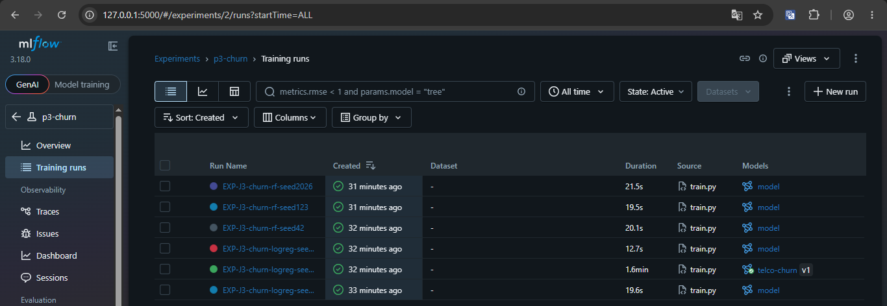

# Preuves MLflow — J3 (23/11 et 25/11/2026)

## Vérifié le 23/11/2026
- Release Helm `mlflow` révision 2, chart 3.18.0, statut `deployed`.
- Pod `mlflow` 1/1 Running, 0 redémarrage en 114 min (pod recréé lors du test de persistance), 443 Mi, 4m CPU.
- PostgreSQL : alembic_version `f4a9b2c7d1e6`, 73 tables (schéma public).
- Smoke test : run `4acbe2600f854c29891f3c7ece519836` relu (params, métrique value=1.0, artefact smoke.txt) après suppression de `mlflow`, `postgres-0`, `minio-0`, et relu de nouveau le 23/11.
- Registre : `telco-churn` v1, alias `champion`, run `988f9b535a714b3a936db5cc194258c0`.
- Rechargement `models:/telco-churn@champion` : prédictions identiques sur 20 lignes (max_diff=0.00e+00), exécuté depuis le poste Windows via tunnel.
- Dataset : sha256 `4cd901ef…6017` (paramètre du run, identique à versions.yaml).
- Image `mlflow:v3.18.0-full` présente sur les 3 nœuds (pré-pull le 23/11, digest identique).

## Vérifié le 25/11/2026
- Pods `mlflow-64b7ff7db8-dqwl7`, `postgres-0`, `minio-0` : 1/1 Running, 0 redémarrage après 42 h (tous sur `k3s-server-3`).
- Appel intra-cluster depuis un pod temporaire : `GET http://mlflow.mlops.svc.cluster.local:5000/health` → HTTP 200 (07:27 UTC). Pas de 403 « Invalid Host header » : `--allowed-hosts` non nécessaire à ce stade. Non testé : nom court `mlflow`, ni un vrai appel de tracking depuis un pod (prévu J4).
- Image `ghcr.io/mlflow/mlflow:v3.18.0-full` présente sur les 3 nœuds (`ctr images ls`).

## Résultats (validation 20 %, 3 graines : 42, 123, 2026)
| Famille | médiane val_f1 | IQR | val_recall |
|---|---|---|---|
| logreg | 0.6275 | 0.0000 | 0.7701 |
| rf | 0.6170 | 0.0018 | 0.6872 |
Test (une seule évaluation, champion) : f1 0.6070, recall 0.7888, roc_auc 0.8348.

Six runs de l'expérience `p3-churn` :

## Limites
- Écart logreg/rf d'environ 0,01 de F1 sur une seule partition (`split_seed=42`) : non démontré comme supérieur au bruit du découpage.
- Pour logreg, les graines changent peu le résultat : IQR=0 ne prouve pas la stabilité.
- Tag `git_commit` des runs : `692f1e4` (commit présent sur `main`; `ml/src/train.py` identique à `1193850`).
- Rechargement testé hors cluster ; test dans un Job prévu en J4.
- Licence du dataset : le dépôt IBM `telco-customer-churn-on-icp4d` est sous Apache-2.0 (LICENSE et README, consultés le 25/11/2026) ; le texte vise le « code pattern », sans licence ni copyright distincts pour `Telco-Customer-Churn.csv`. Le paramètre `dataset_license` des runs (« IBM Sample Data / Apache-2.0 ») est une formulation non étayée par ces documents ; non modifiée car les runs sont déjà enregistrés. Usage pédagogique ; CSV non versionné dans notre dépôt.
- Les trois pods (`mlflow`, `postgres-0`, `minio-0`) tournent sur `k3s-server-3` (observation, cause non établie). Aucun test de bascule : prévu le 14/12 (R3).
- DNS des VM : contournement manuel (`1.1.1.1`), perdu au redémarrage d'une VM. Un reboot avant la démo peut empêcher tout pull d'image non présente (l'image MLflow est présente sur les 3 nœuds, pas `curlimages/curl`).